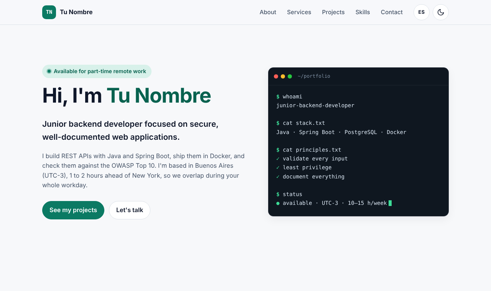

# Portfolio · Tu Nombre

Personal portfolio of a junior backend developer (Java · Spring Boot · PostgreSQL · Docker), available for part-time remote work.

**Live site:** https://TU-USUARIO.github.io/portfolio/



## Highlights

- **No frameworks, no build step.** Plain HTML, CSS and JavaScript, so it loads fast and anyone can read the code.
- **Bilingual (EN / ES).** The language is detected from the browser and can be switched with one click. The choice is remembered.
- **Light and dark themes.** Follows the system preference by default, with no flash of the wrong theme on load.
- **Content separated from code.** Every text, project and skill lives in [`assets/js/data.js`](assets/js/data.js). Adding a project means editing one object, not the HTML.
- **Accessible.** Skip link, semantic landmarks, visible focus styles, ARIA live regions for the project filter and form, and support for `prefers-reduced-motion`.
- **Responsive.** Mobile-first layout with no horizontal scrolling down to 320 px.

## Learning hub

[`aprender.html`](aprender.html) is my public study roadmap (in Spanish): a staged checklist, 15 topic cards with first steps and resources, 9 reasoning-based quizzes with explanations and spaced repetition, and a weekly plan. Progress is stored locally and can be exported or imported as JSON (imports are validated against a whitelist).

## Security decisions

This portfolio targets application-security work, so the site follows the same principles I apply to client projects:

| Decision | Why |
|---|---|
| Strict **Content Security Policy** (`script-src 'self'`, no inline scripts or styles) | Blocks injected scripts, even if content were compromised. |
| **No `innerHTML`**: all content is rendered with `textContent` and DOM APIs | Content from `data.js` can never be interpreted as HTML (prevents XSS). |
| **No third-party scripts, fonts or trackers** | No supply-chain risk and no visitor data shared with anyone. |
| External links use `rel="noopener noreferrer"` | Prevents reverse tabnabbing. |
| Contact form uses `mailto:`, with no backend | No server to attack and no personal data stored. |
| `localStorage` access wrapped in `try/catch` | The site keeps working when storage is blocked (private mode). |

## Project structure

```
.
├── index.html               # Page structure (semantic HTML)
├── 404.html                 # Custom "not found" page
├── aprender.html            # Learning hub
├── assets/
│   ├── css/styles.css       # Design tokens, themes, layout
│   ├── js/data.js           # ← ALL portfolio content lives here
│   ├── js/learn-data.js     # Learning hub content (topics, quizzes)
│   ├── js/learn.js          # Learning hub logic
│   ├── css/learn.css        # Learning hub styles
│   ├── js/main.js           # Rendering, i18n, theme, filters, form
│   ├── js/theme-init.js     # Applies the theme before first paint
│   └── img/favicon.svg
├── docs/                    # README screenshots
└── .github/workflows/
    ├── deploy.yml           # Deploys to GitHub Pages on push to main
    └── checks.yml           # HTML validation + JS syntax check
```

## Run locally

No installation needed. Either open `index.html` in a browser, or serve the folder:

```bash
python3 -m http.server 8000
# then open http://localhost:8000
```

## Deployment

Every push to `main` triggers `.github/workflows/deploy.yml`, which publishes the site to GitHub Pages. `checks.yml` validates the HTML and the JavaScript on every push and pull request.

## Contact

- Email: tu-email@ejemplo.com
- LinkedIn: https://www.linkedin.com/in/TU-USUARIO
- GitHub: https://github.com/TU-USUARIO

## License

Code released under the [MIT License](LICENSE). Personal content (texts and project descriptions) © Tu Nombre.
